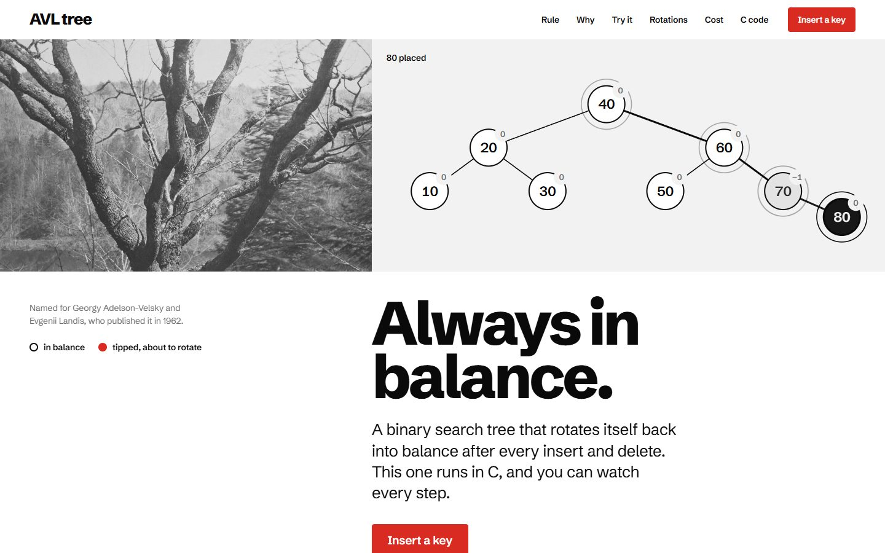

# AVL Tree — Always in Balance

An interactive guide to self-balancing binary search trees, by [Ansh](https://github.com/anshcantcode) and [Anjelina](https://github.com/anjylearns-23).

**[Open the visualizer](https://anshcantcode.github.io/avl-tree/)** · [C implementation](src/avl.c) · [MIT license](LICENSE)

Insert a key and watch the tree settle. Every comparison, height update, and rotation is recorded by a C implementation compiled to WebAssembly, then played back as an SVG animation.



## Explore

- Insert, delete, and search with a step-by-step explanation and highlighted C code.
- Try all four rotation cases: left-left, right-right, left-right, and right-left.
- Traverse in-order, pre-order, post-order, or level-order.
- Pause, replay, scrub through steps, and adjust playback speed.
- Compare an AVL tree with a plain binary search tree given the same sorted keys.
- Inspect heights, balance factors, comparisons, and rotation counts.

The visualizer holds up to **31 keys** to keep the diagrams readable. Duplicate keys are rejected. Reduced-motion preferences are respected.

## Run locally

Clone the repository and open `index.html` in a modern browser. The WebAssembly module is already included, so no build, package installation, or backend service is needed.

```sh
git clone https://github.com/anshcantcode/avl-tree.git
cd avl-tree
python -m http.server 8000
```

Then visit [localhost:8000](http://localhost:8000). Opening `index.html` directly also works. The optional Google Fonts stylesheet needs an internet connection; system fonts are used if it is unavailable.

## Build and verify

To change the algorithm, install Python, PowerShell 7, and Zig's Python package:

```sh
python -m pip install ziglang==0.17.1
pwsh -File build.ps1
```

This compiles `src/avl.c` into `build/avl.wasm`, updates the embedded module in `js/avl-wasm.js`, and runs the native tests. The tests cover the four rotations, deletion, search, traversals, duplicate keys, capacity, and 20,000 randomized operations against a reference set.

With Node.js 22 or later, also check the actual browser bridge and embedded module:

```sh
node test/test_wasm.cjs
```

## Project layout

| Path | Purpose |
| --- | --- |
| `index.html` | Educational page and visualizer controls |
| `css/style.css` | Responsive layout, typography, and motion |
| `src/avl.c` | AVL implementation and event snapshots |
| `js/avl-wasm.js` | Embedded WebAssembly generated from C |
| `js/avl.js` | JavaScript bridge to WebAssembly |
| `js/view.js` | SVG tree rendering and animation |
| `js/app.js` | Playback, controls, examples, and teaching diagrams |
| `test/` | Native algorithm and WebAssembly integration checks |

## Contributing

See [CONTRIBUTING.md](CONTRIBUTING.md) for the local workflow. Bug reports and focused improvements are welcome.

## License and images

Code is available under the [MIT license](LICENSE), copyright © 2026 Ansh. Archival photographs are credited in the page footer and [THIRD_PARTY_NOTICES.md](THIRD_PARTY_NOTICES.md); their licenses are separate from the code license.
